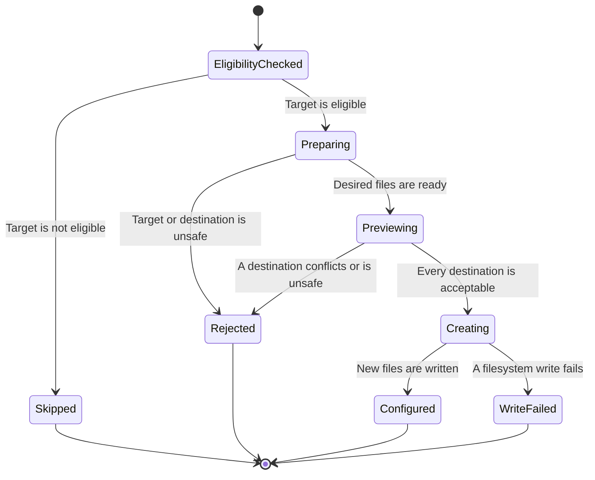

# Baseline Installation States

The Harness baseline installer checks eligibility before it inspects a target.
For eligible targets it prepares the desired files and previews destination conflicts before creating any files.

Existing identical files are kept, and the Gradle catalog retains its target-owned contents.
The preview rejects conflicting files and unsafe destinations before creation begins.
A later filesystem failure during creation can leave partial output, so the preview is not a transaction against concurrent filesystem changes.

The generated property in `plugins/harness/tests/baseline-state-properties.test.ts` puts a conflicting file at each generated destination for selected profiles.
It checks that rejection preserves the conflict and the target directory entries.
