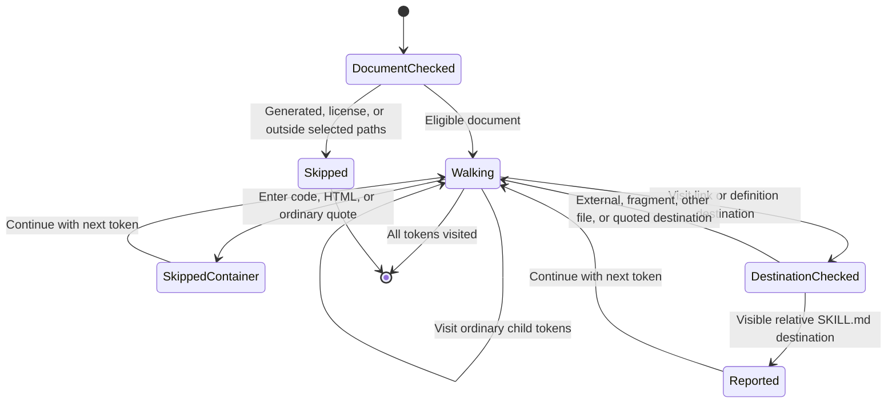

# Relative Skill Link Checks

The Harness Markdown rule checks eligible documents for relative links to skill files.
It reports the destination without changing the source.

The rule strips query strings and fragments and decodes unreserved percent escapes before checking the filename.
Absolute paths, URL schemes, and fragment-only links stay outside the diagnostic.
Code, HTML, and ordinary block quotes are not traversed, while alert block quotes are traversed.
Generated documents and license files are excluded before traversal.

The generated-input properties in `plugins/harness/tests/skill-link-properties.test.ts` exercise the production rule through Markdownlint.
They check that relative destinations remain visible across directory depths, suffixes, and preceding prose, and that external destinations do not produce relative-link diagnostics.
