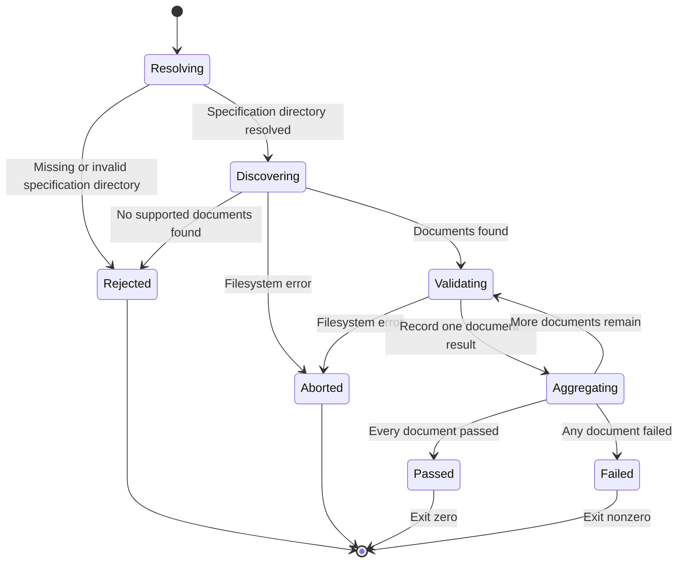

# Specification Validation States

The specification validator discovers supported documents under the selected specification tree.
When discovery and reads succeed, it validates every discovered document and aggregates the results before choosing an exit status.
Unexpected filesystem errors can abort validation before the summary.

Each document contributes one pass or failure to the summary, even when it has multiple diagnostics.
The command checks SPEC, RESEARCH, and CONTRACT documents before reporting the aggregate.

The generated property in `plugins/spec-driven-development/tests/validation-state-properties.test.ts` checks every combination of valid and invalid documents across the three kinds.
It verifies the total, passed and failed counts, and exit status.
